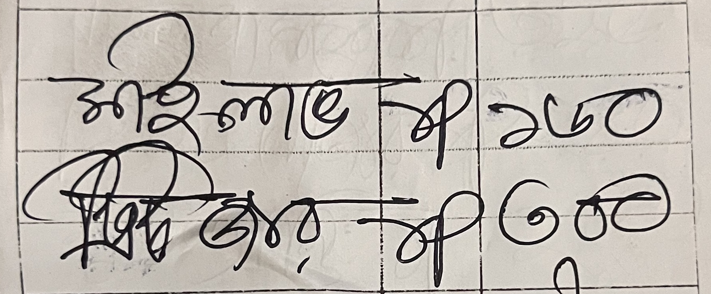
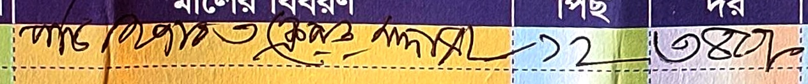
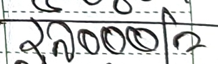
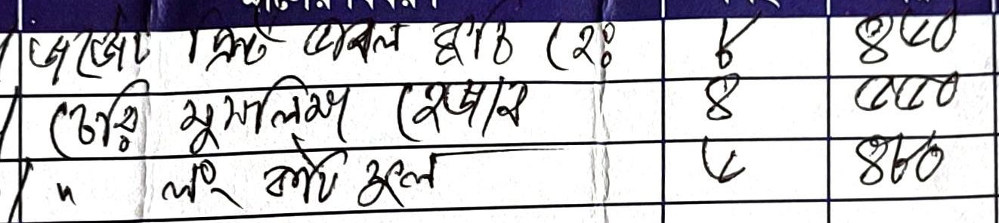
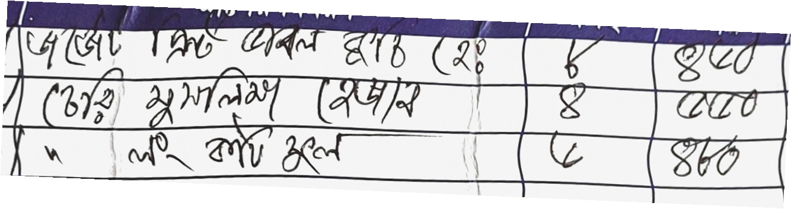
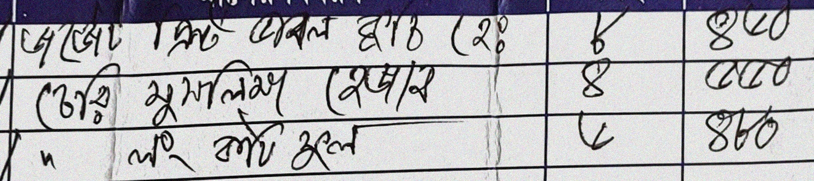

# BanglaMemo: A Handwritten Bangla Receipt Dataset for OCR

A novel dataset of **698 handwritten Bangla receipt images** collected from local marketplaces in Dhaka, annotated with bounding boxes and Bangla transcriptions, and formatted for **PaddleOCR** text recognition training.

## Overview

BanglaMemo addresses a critical gap in Bangla handwriting recognition research — the absence of real-world receipt data with messy, informal handwriting. Existing Bangla OCR datasets focus on isolated characters or clean, printed text. This dataset captures the real-world challenges of marketplace receipts:

- Highly variable handwriting quality
- Mixed Bangla and English text
- Inconsistent layouts across store formats
- Environmental noise (creases, smudges, colored backgrounds)
- Bangla numerals mixed with Arabic numerals

## A look at the data

Three crops from the test split with their labels:

| Crop | Label |
|:---|:---|
|  | মাইলাভ ১p ১৬০ ট্রিটজার ১p ৩০০ |
|  | পার্ট হিজাব ক্লেমার সাদা ১২ ৩৪০ |
|  | ২৯০০০ |

The same item crop before and after two of the augmentations:

| Original | Paper crumple | Ink smudge |
|:---:|:---:|:---:|
|  |  |  |

The project slides are in [`docs/index.html`](docs/index.html), viewable at
https://saminyeaserkhan.github.io/BanglaMemo/ once GitHub Pages is turned on.

## Dataset Statistics

| Metric | Count |
|:---|---:|
| Total labeled receipts | 622 |
| Training samples (with 4× augmentation) | 5,175 |
| Validation samples | 122 |
| Test samples | 64 |
| Unique characters | 138 |
| Augmentation techniques | 9 |

### Split Distribution

| Split | Items Crops | Total Crops |
|:---|---:|---:|
| Train (original + augmented) | 2,640 | 2,535 |
| Validation (original only) | 62 | 60 |
| Test (original only) | 32 | 32 |

## Repository Structure

```
BanglaMemo/
├── Dataset_PaddleOCR/           ← Ready-to-use PaddleOCR dataset
│   ├── train/
│   │   ├── items_crops/         (2,640 images)
│   │   ├── total_crops/         (2,535 images)
│   │   ├── rec_items_train.txt
│   │   └── rec_total_train.txt
│   ├── val/
│   │   ├── items_crops/         (62 images)
│   │   ├── total_crops/         (60 images)
│   │   ├── rec_items_val.txt
│   │   └── rec_total_val.txt
│   ├── test/
│   │   ├── items_crops/         (32 images)
│   │   ├── total_crops/         (32 images)
│   │   ├── rec_items_test.txt
│   │   └── rec_total_test.txt
│   ├── char_dictionary.txt      Character dictionary (138 chars)
│   └── dataset_report.txt       Full dataset statistics
│
├── Labeled_CSV/                 Raw annotation CSVs from Label Studio
├── docs/                        Project slides (HTML) and images, for GitHub Pages
│
├── prepare_dataset.py           Step 1: Clean, crop, and format labels
├── validate_and_merge.py        Merge and validate Label Studio exports
├── augment_dataset.py           Step 2: Augment and split into train/val/test
├── test_augment_intensity.py    Visual comparison of augmentation intensities
│
├── merged_labels.csv            Merged annotations from all CSV batches
├── Project_Report.md            Full project report / paper draft
└── .gitignore
```

## Quick Start: Running PaddleOCR

### 1. Clone the Repository

```bash
git clone https://github.com/SaminYeaserKhan/BanglaMemo.git
cd BanglaMemo
```

### 2. Install PaddleOCR

```bash
pip install paddlepaddle paddleocr
```

### 3. Configure PaddleOCR for Training

Point PaddleOCR's recognition config to the dataset:

```yaml
Train:
  dataset:
    name: SimpleDataSet
    data_dir: ./Dataset_PaddleOCR/train/
    label_file_list:
      - ./Dataset_PaddleOCR/train/rec_items_train.txt
      - ./Dataset_PaddleOCR/train/rec_total_train.txt

Eval:
  dataset:
    name: SimpleDataSet
    data_dir: ./Dataset_PaddleOCR/val/
    label_file_list:
      - ./Dataset_PaddleOCR/val/rec_items_val.txt
      - ./Dataset_PaddleOCR/val/rec_total_val.txt

Global:
  character_dict_path: ./Dataset_PaddleOCR/char_dictionary.txt
  use_space_char: true
```

### 4. Run Testing / Evaluation

```bash
# Test with the test split
python tools/eval.py -c your_config.yml \
  -o Global.checkpoints=your_trained_model \
  Eval.dataset.data_dir=./Dataset_PaddleOCR/test/ \
  Eval.dataset.label_file_list=["./Dataset_PaddleOCR/test/rec_items_test.txt","./Dataset_PaddleOCR/test/rec_total_test.txt"]
```

## Label Format

Labels follow PaddleOCR's standard text recognition format:

```
<relative_image_path>\t<transcription>
```

Example:
```
items_crops/receipt_551_items.jpg	১৫kg ডিম  পেয়াজ  আলু  তেল  ১২০p ৩১০/= ৫kg ১.৬০০k ১২৫০/= ৫১০/= ২৮০/=
total_crops/receipt_001_total.jpg	৮৭৬০
```

## Augmentation Techniques

Training images are augmented with random combinations of:

| Technique | Parameters |
|:---|:---|
| Brightness adjustment | ±20% |
| Contrast adjustment | ±20% |
| Slight rotation | ±3° |
| Gaussian noise | σ = 5–15 |
| Gaussian blur | radius 0.5–1.5 |
| Perspective warp | ±2% |
| JPEG compression | quality 50–85 |
| Paper crumpling/folding | 3–10px waves + fold lines |
| Ink smudging | kernel 5–13px, motion blur |

Augmentation is applied to the **training set only**. Validation and test sets contain unmodified originals.

## Pipeline

The dataset was built using a 3-stage pipeline:

1. **`validate_and_merge.py`** — Merges 6 Label Studio CSV exports, validates annotations, and produces `merged_labels.csv`
2. **`prepare_dataset.py`** — Cleans corrupted transcriptions, crops item regions and total amounts from full receipt images, generates character dictionary
3. **`augment_dataset.py`** — Splits into train/val/test (85/10/5%), applies 4× augmentation to training set, produces PaddleOCR-formatted label files

## Team

Built by a team of three for the Digital Image Processing course at United International
University, June 2026. The team collected and annotated the receipts together;
[Samin Yeaser Khan](https://github.com/SaminYeaserKhan) wrote the processing pipeline
(`validate_and_merge.py`, `prepare_dataset.py` and `augment_dataset.py`).

## License

This dataset is provided for academic and research purposes.
